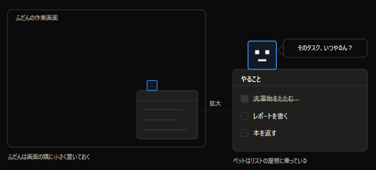
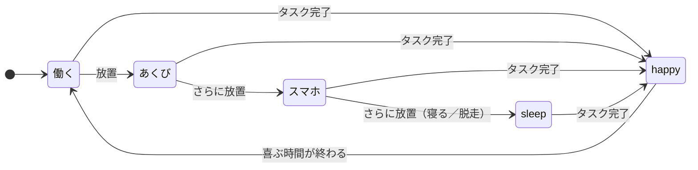

# サボるドット絵くん ― プロジェクト概要書

## 目次

- [コンセプト](#コンセプト)
- [どんなアプリか](#どんなアプリか)
- [デスクトップアプリとしての運用](#デスクトップアプリとしての運用)
- [スコープ](#スコープ)
- [コア仕様：サボり進行](#コア仕様サボり進行)
- [難しくなりそうなところ](#難しくなりそうなところ)
- [マイルストーン](#マイルストーン)
- [設計方針](#設計方針)
- [将来の拡張](#将来の拡張)

## コンセプト

デスクトップの隅に常駐するドット絵キャラが、タスクを放置すると勝手にサボり始めるToDoアプリ。

面白さの中心は**時間**にある。働くキャラを眺めるアプリではなく、見ていないと怠けるキャラを飼うアプリ。タスクを消化している間は真面目に働き、放置が続くとあくびをし、スマホをいじり、最後は寝るか画面外へ脱走する。

実用性はオマケと割り切る。優先順位は「くだらなさ」と「見てて楽しい」。ToDo機能は追加・完了・削除があれば足りる。

キャラは人間アバターの予定。人間アバターだと画面の邪魔になるようなら、人間アバターとペットのペアに変更し、全画面では人間アバター、縮小時はペットを表示する（仮案）。

## どんなアプリか

やることリストと、その屋根に乗ったペットでひとつの窓になっている。画面の隅に小さく置いておくと、リストを片づけている間はおとなしく座っているが、放置するとその場で寝たり、吹き出しで文句を言い始める。

## デスクトップアプリとしての運用

このアプリは常駐して初めて成立する。ウィンドウを閉じたら消えるキャラは、サボっているところを見てもらえない。ユーザーが別の作業をしている間も、視界の端に居座り続ける必要がある。

## スコープ

C++とSDLを必須の技術と決めたため、**2Dに限定**する。

3Dにすると、モデルの読み込みから関節の動きまで自前で作ることになり、キャラが動き出す前に時間を使い切る。2Dなら、使う道具が絵の表示まで面倒を見てくれる。

### 初版でやること

- 背景が透明で、常に手前に表示される小さなウィンドウ
- 状態ごとに切り替わるドット絵キャラの表示
- ToDoの追加・完了・削除
- 経過時間によるサボり進行
- 吹き出しによる煽りセリフ
- ドラッグによる移動

### やらないこと

- 3Dモデル（絵は2Dのドット絵だけ）
- クラウド同期、アカウント機能
- Windows以外への対応（macOS、Linux、モバイル）
- 複数キャラの同時常駐

## コア仕様：サボり進行

材料は「最後にタスクを片づけてからの経過時間」という数字ひとつ。これだけで今の状態が決まる。

### 状態マシン（4状態＋happy割り込み）

> 図は本文の説明から起こしたもの。各状態へ進む秒数は未定（等速だと寝るまで約3分）。

### 実装ルール

| 項目 | 方針 | 理由 |
|---|---|---|
| 段階を進める秒数 | 判定を1か所にまとめて書く | 数字を変えたくなったとき、そこだけ直せば済む |
| 喜ぶ演出（happy） | 「いつまで喜ぶか」の時刻を記録して判定する | 一定時間で元に戻す作りだと、連続でタスクを片づけたときに表示が乱れる |
| セリフ | 1か所にまとめる。状態が変わった瞬間は必ず喋り、サボり続けている間は低確率でときどき煽る | ― |
| 開発中の時間 | 10倍速にして試す | 等速だと寝るまで3分かかり、動作確認が面倒になって確認しなくなる |

## 難しくなりそうなところ

初版はWindowsだけを対象にする。手こずりそうなのは次の3つで、どれもOSの作りに踏み込む必要があり、既成の機能で済ませられない。

| 課題 | 内容 |
|---|---|
| ペットの背後をクリックできるようにする | 透明な部分でクリックを受け止めてしまうと、下にあるアプリが操作できなくなる。既成の機能がないので自分で用意する |
| ほかのアプリを使っている間のキー入力を知る | 打鍵に反応させるために要る。Windowsには仕組みがあるが、常に受け取り続ける作りにする必要がある |
| 配布 | 実行ファイルをそのまま渡せる。ただし署名がないと初回起動時に警告が出るので、渡す相手には一言添える |

1つめは、使う予定の道具（SDL）の側でも[未解決の課題](https://github.com/libsdl-org/SDL/issues/12683)として議論が残っている段階。自分で用意する前提で見ておく。

3つとも必須ではない。時間だけでサボる挙動なら無くても成立するので、詰まったら後回しでよい。

## マイルストーン

フェーズAの4つが終わった時点で「デスクトップに住んでサボるキャラ」として成立する。5以降は無くても成立するので、詰まったら後回しでよい。

### フェーズA ― まず動かす

| # | やること | 完了条件 |
|---|---|---|
| 1 | 透過ウィンドウに四角を描く | デスクトップに四角が浮かび、枠もタスクバーアイコンも出ない |
| 2 | ドラッグで移動できるようにする | 掴んで動かせて、離した位置に留まる |
| 3 | サボり進行の状態マシンを実装する | 放置すると四角の色が4段階で変わる |
| 4 | スプライトシートで四角を置き換える | ドット絵がぼけずに表示され、状態ごとに切り替わる |

### フェーズB ― 常駐らしくする

| # | やること | 完了条件 |
|---|---|---|
| 5 | グローバル入力フックを入れる | 他のアプリを操作中でも打鍵を検知できる |
| 6 | クリックスルーとトレイ常駐 | キャラの背後をクリックでき、トレイから終了できる |
| 7 | 配布できる形にする | 別のWindows機で起動する |

最初の関門は1番。ここが通れば残りは地続きになる。ToDo機能の実装は3番と並行でよく、単独のマイルストーンには置かない。

## 設計方針

- **見た目の切り替えは1か所にまとめる**
  ほかの部分は状態の名前を渡すだけにして、四角からドット絵への差し替えがそこだけで済むようにする。
- **サボり方のルールは見た目から切り離す**
  先にプレースホルダの四角で挙動を完成させ、絵は後から差し込む。この順序なら、絵が未完成でもサボり方を詰められる。逆に絵を先に描くと、状態を減らしたくなったときに描いた分が無駄になる。
- **ドット絵はAsepriteで作り、1枚のスプライトシートに書き出す**
  状態ごとのフレームを横並びにする。切り出し矩形の計算が単純になり、フレームの追加にも耐える。
- **キャラのサイズは16の倍数にそろえる**
  ドット絵は16×16や32×32で描くことが多く、整数倍で拡大するとにじまない。

## 将来の拡張

初版が動いてから検討する。どれも初版の完成を待たずに手をつけると、常駐の基礎が固まる前に発散する。

| 機能 | 内容 |
|---|---|
| キー入力連動 | 打鍵中は働き、手が止まるとサボる。デスクトップアプリだから作れる機能で、最も効果が大きい |
| やる気ゲージ | 未完了タスクが多いほど進行が速くなる。溜めるほど早くサボる |
| サボりの抽選 | `sleep` を「寝る／コーヒー／脱走」からランダムに選ぶ |
| 効果音 | 打鍵音、あくび。SDL3の音声機能で足りる |

### 初版後も検討しないもの

クラウド同期、3D化、Live2D対応の3つは、スコープの線引きを壊すため初版後も検討しない。
