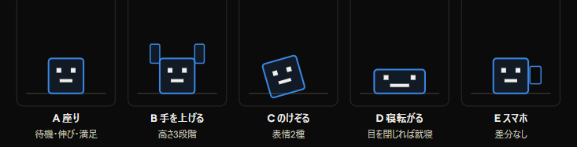

# roommate ― キャラクター設定書

Oct 30, 2026 · @saku

## どんなキャラか

このキャラはユーザーを見張っていない。隣に住んでいて、片づけるたびに褒めてくれるが、自分は先に力尽きて寝る。

セリフ22個を見ると、ユーザーを責める言葉がひとつもない。ネガティブなのは「つかれた」「だるい」「もう寝よ」の3つだけで、どれも**自分が疲れている**話。「頑張りすぎじゃない？」「大丈夫？？」も咎めではなく心配で、タスクを溜めたことを非難していない。

だから監督でも上司でもなく、同居人。`roommate` という名前はこの関係そのものを指している。

**書き足すときの原則**：キャラはタスクの進み具合を評価しない。片づけたら喜び、増えたら応援し、放置したら自分がだれる。ユーザーの怠惰を指摘するセリフは足さない。これを守れば、セリフを増やしても性格がぶれない。

## 2つの姿

**縮小時はペット、全画面時は人間アバター**。窓のサイズに連動して姿が変わる。

**フルサイズ** — 左に縦のサイドバー（ToDo ／ アバター ／ 設定）。本体の背景は透過で、タスクのリストパネルだけが浮いている。人間アバターはそのパネルの上端に肘をついて寄りかかり、吹き出しは右側に出す。タスクは下線だけの行。

**縮小** — 画面の隅にパネルが1枚。ペットはパネルの左上角に座り、吹き出しは右へ。タスクは下線ではなく**ピル（角丸のバー）**で並べる。狭い幅でも行が潰れないため。

どちらもパネルは半透明にする。デスクトップの壁紙が透けることで、アプリというより置物に見える。

既定は縮小。画面の隅に置きっぱなしにするのが本来の使い方なので、表示時間が圧倒的に長いのはペットのほう。全画面は、タスクをまとめて整理するときだけ開く状態になる。

ただし**作画量が2倍になる**。ペット形態だけで作品は完全に成立するので、人間アバターは後回しでいい。先にペットを全ポーズ仕上げて、動くところまで持っていくことを勧める。

2つが同一人物に見える必要はない。別の存在として扱ってもいいし、色を揃えて「同じ家の住人」にしてもいい。ここは好みで決める。

## キャラごとに性格を変える

アバターは複数用意して、ユーザーが選べるようにする。サイドバーの「アバター」がその選択画面になる。

**差し替わるのはセリフと絵だけ。** 場面の種類もポーズ構成も全キャラ共通にする。こうすると、場面を判定するコードは1つのまま、キャラごとのセリフ辞書を切り替えるだけで性格が変わる。

このドキュメントのセリフ一覧は、デフォルトキャラのもの。「褒めてくれるが自分は先に力尽きる」性格で、スケッチの「頑張るね〜」「ふーん やるじゃん」もこの線上にある。

別キャラは振り幅で作ると差が出る。素っ気ない、テンションが高い、毒舌、敬語——同じ「1つ完了」の場面で何を言うかだけで、別人に見える。

**ただし最初は1体に絞る。** キャラが増えるたびに全ポーズを描き直すことになるので、1体目が完成してから2体目を考える。

## セリフ一覧

以下はデフォルトキャラのセリフ。キャラを変えると辞書ごと差し替わる。

| 場面 | きっかけ | セリフ |
| --- | --- | --- |
| 起動直後 | アプリを立ち上げる | やっほー（スマホを見たまま） |
| 1つ完了 | タスクを1つチェック | やるじゃん ／ いいね ／ えら ／ 天才 |
| 複数完了 | 短時間に2つ以上チェック | まじ？ ／ えぐ ／ 神やん ／ 最高 |
| 全部完了 | 残りが0になる | 全部終わったー！ ／ 流石に惚れる ／ お疲れ様 |
| タスク0個 | 未完了が0の状態が続く | 無言（満足そうにしている） |
| 追加 | タスクを1つ足す | がんばれー ／ おお ／ すげ |
| 追加（5個以上） | 追加前の未完了が5個以上の状態で足す | 頑張りすぎじゃない？ ／ めっちゃあるやん ／ 大丈夫？？ ／ 終わる？？ |
| 溜めたまま放置 | 未完了があり、一定時間操作なし | つかれた ／ だるい ／ もう寝よ |
| 長時間放置 | さらに時間が経つ | 無言（寝る） |

「操作」はタスクの追加と完了の2つを指す。完了したタスクは自動的に削除するため、削除の操作と場面はない。

「複数完了」の判定は未決。一定時間内に2つ以上チェックしたら、と考えているが、秒数は実装しながら決める。

「複数完了」と「全部完了」が同時に成立したときは、「全部完了」を優先する。

長時間放置で無言にするのは意図的。喋らないことで「本当に寝た」が伝わる。ここでセリフを出すと、寝ている演出が弱くなる。

## ポーズの体系

セリフは22個あるが、ポーズは22個要らない。体の状態で数えると**5種類**に収まり、残りは表情と腕の高さの差分でまかなえる。

Cがいちばん得する。「まじ？」（複数完了）と「大丈夫？？」（5個以上）は意味が真逆なのに、体の動きは同じ「のけぞり」。目を差し替えるだけで両方賄える。

## 場面とポーズの対応

| 場面 | ポーズ | 表示時間 |
| --- | --- | --- |
| 起動直後 | E スマホ | 3秒 |
| 待機（消化中） | A 座り | 常時・呼吸ループ |
| 1つ完了 | B 手を上げる（低） | 2秒 |
| 複数完了 | C のけぞる（目を見開く） | 2秒 |
| 全部完了 | B 手を上げる（高） | 3秒 |
| タスク0個 | A 座り（満足の表情） | 常時 |
| 追加 | B 手を上げる（中） | 2秒 |
| 追加（5個以上） | C のけぞる（汗） | 2秒 |
| 溜めたまま放置 | D 寝転がる ／ E スマホ ／ A 伸び | ランダム抽選 |
| 長時間放置 | D 寝る | 常時 |

表示時間が過ぎたら待機に戻る。ただし戻し方はタイマーではなく「いつまでそのポーズか」を記録して毎フレーム判定する。連続でチェックしたときにポーズが競合しないようにするため。

「溜めたまま放置」の3種は抽選で切り替える。毎回同じ順番だと、2回目で飽きる。全部完了の3秒が終わると残りは0なので、そのままタスク0個の満足顔に流れる。褒めたあとに満足して座っている、という自然なつながりになる。

**落ち着きがないのは描かなくていい。** 待機ポーズを左右に1pxずつ揺らすだけで、そわそわして見える。コード側の仕事にすれば、絵が1枚浮く。

## 描く順番

画面に出ている時間の長いものから描く。全体の印象は、一瞬しか映らない絵ではなく、ずっと映っている絵が決める。

1. **A 座り** と **D 寝る** — この2つだけで作品が成立する。表示時間が圧倒的に長いので、ここの完成度が全部を決める
2. **A の表情差分（満足）** — タスク0個のとき。目を細めるだけで済む
3. **D 寝転がる** と **E スマホ** — サボりのバリエーション。E は起動直後にも使い回せる
4. **B 手を上げる（3段階）** — 褒める系。2〜3秒しか映らないので、多少雑でも成立する
5. **C のけぞる（2種）** — 最後でいい
6. **人間アバター一式** — ペットが全部動いてから着手する

1が終わった時点で一度アプリに差し込んで、実際に屋根の上に置いてみるのを勧める。小さく表示すると印象が変わるので、残りを描く前に確認したほうが手戻りが少ない。

## 作画ルール

- **キャンバスは横長にする** — 寝転がると横に広がるので、正方形だとはみ出る。ペットは 64×48 を基準にして、全ポーズを同じサイズで描く
- **接地面の高さを全ポーズで固定** — 屋根の上に乗っている構図なので、ここがずれると浮いたり沈んだりする。アンカーは「足元の中央」で統一
- **表情を別レイヤーに** — C ののけぞり2種、D の寝転がりと寝る、A の待機と満足が、すべて目の差し替えだけで済む
- **色は4〜6色まで** — 屋根の上に小さく置くので、色数が多いと潰れる
- **フレームは1ポーズ2〜4枚** — それ以上は動きが増えるだけで、小さい表示では違いが見えない
- **人間アバターはペットと同じポーズ構成にする** — 同じ5シルエットで揃えれば、コード側は姿を切り替えるだけで済み、場面ごとの分岐が増えない
- **2形態で色を共有する** — パレットを同じにしておくと、切り替わっても世界が変わらない

書き出しは、状態ごとのフレームを横並びにした1枚のスプライトシート。切り出し矩形の計算が単純になり、あとからフレームを足しても崩れない。

## 未決事項

- [ ] **「複数完了」の判定時間** — 何秒以内に2つチェックしたら複数扱いにするか
- [ ] **姿の切り替えトリガー** — 窓のサイズに自動連動させるか、ユーザーが切り替えるか
- [ ] **デフォルトキャラの見た目** — 人型アバターとペットそれぞれの造形
